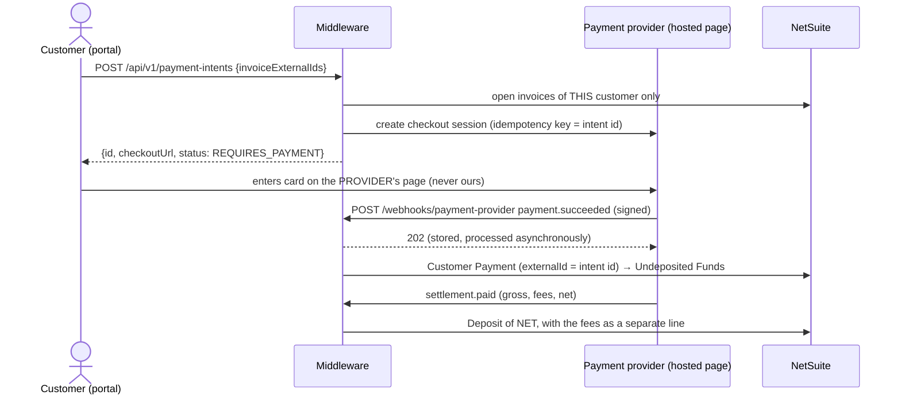

# Customer payment API and webhook contract (Phase 8)

## Customer payment flow



## Endpoints

| Method and path | Role | Notes |
|---|---|---|
| `POST /api/v1/payment-intents` | customer, ar_clerk | `Idempotency-Key` is required. The body is **strict**: card fields are rejected. A customer can only pay their own invoices. |
| `GET /api/v1/payment-intents/{id}` | customer (own only), ar_clerk | Another customer's intent returns 404 |
| `POST /api/v1/payment-intents/{id}/capture` | ar_clerk | Manual-capture mode only |
| `POST /api/v1/payment-intents/{id}/void` | ar_clerk | Cancels an authorization. No accounting entry. |
| `POST /api/v1/payment-intents/{id}/refunds` | ar_clerk | Returns `202 PENDING_PROVIDER_CONFIRMATION`. NetSuite is updated only when the provider's webhook confirms. |
| `GET /api/v1/settlements` | ar_clerk, ops | |
| `GET /api/v1/ar/aging?asOf=` | ar_clerk, ops | Buckets: CURRENT, 1-30, 31-60, 61-90, 90+ |
| `POST /api/v1/ar/collections/run` | ar_clerk, ops | Idempotent per invoice and stage |
| `GET /api/v1/ar/collections/actions?invoice=&customer=` | ar_clerk, ops | The communication audit trail |
| `POST /api/v1/invoices/{id}/dispute` | ar_clerk | `{disputed, note}` |

## Webhook: `POST /webhooks/payment-provider`

### Authentication

`X-Signature: t=<unix>,v1=<hex HMAC-SHA256(secret, "<t>.<raw body>")>`

The request is rejected (401 `WEBHOOK_SIGNATURE_INVALID`) when:

- the header is missing or malformed;
- the HMAC does not match;
- `|now − t| > 300 s`. This is the replay protection.

### Envelope (versioned)

```json
{ "id": "evt_…", "version": "2026-01", "created": "2026-11-20T09:00:00Z", "type": "payment.succeeded", "data": { … } }
```

An unknown `type` or `version` gets a 400 response, and nothing is stored. When the provider adds a
new version, the schema is extended **alongside** the existing one. We never change the meaning of an
existing version.

| `type` | `data` | Effect |
|---|---|---|
| `payment.authorized` | sessionId, intentId, amount, currency | Intent → AUTHORIZED (no accounting) |
| `payment.succeeded` | sessionId, intentId, amount, currency | Intent → SUCCEEDED, then **Customer Payment** in NetSuite |
| `payment.failed` | sessionId, intentId, reason | Intent → FAILED |
| `payment.voided` | sessionId, intentId | Intent → CANCELED |
| `refund.succeeded` | refundId, sessionId, intentId, amount, currency | Intent → PARTIALLY_REFUNDED or REFUNDED, then **Customer Refund** |
| `payment.returned` | sessionId, intentId, amount, currency, reasonCode | Intent → RETURNED, then a reversal (**the accounting policy must be reviewed**) |
| `settlement.paid` | settlementId, date, currency, gross, fees, net, payments[] | Arithmetic is checked, then a **Deposit** of net with fees separate. A mismatch becomes an exception and nothing is posted. |

### Responses

| Status | Meaning | What the provider does |
|---|---|---|
| `202 {status:"accepted"}` | Stored. It will be processed asynchronously. | Stops retrying |
| `200 {status:"duplicate"}` | Event ID already received. Nothing is done. | Stops retrying |
| `400` | Payload not understood | Usually stops. Its own alerting fires. |
| `401` | Bad signature | Should not happen for the real provider. Investigate. |
| `5xx` | Our problem | Retries later. That is safe, because the event ID makes it idempotent. |

### Delivery more than once

- Every event is stored under its **event ID**, which is the primary key. A second delivery is
  answered with 200 and changes nothing.
- Each handler is also idempotent on business state. For example, `payment.succeeded` for an intent
  that is already SUCCEEDED does nothing. This covers providers that emit two different event IDs for
  the same fact.

## Fees and net settlement

| | Amount |
|---|---|
| The customer paid (gross) | 500.00 |
| Provider fee (2.9% + 0.30) | 14.80 |
| Net received in the bank | 485.20 |

- The Customer Payment is 500.00. The customer's AR is fully cleared.
- The Deposit totals 485.20, and the 14.80 fee goes to the merchant-fee expense account.
- The deposit then equals the bank statement line exactly, which makes reconciliation (Phase 10)
  possible.

## Collections rules

| Days past due | Stage | Action |
|---|---|---|
| ≤ 0 | NONE | — |
| 1–29 | REMINDER_1 | Email `nsd-friendly-reminder` to the customer |
| 30–59 | REMINDER_2 | Email `nsd-second-notice` |
| ≥ 60 | ESCALATED | Internal message to the AR manager |
| Disputed | (paused) | No reminders until the dispute is closed |

- Stages never move backwards automatically.
- The same thresholds are used in NetSuite (`nsd_rules.collectionStage`). A parity test enforces this.
