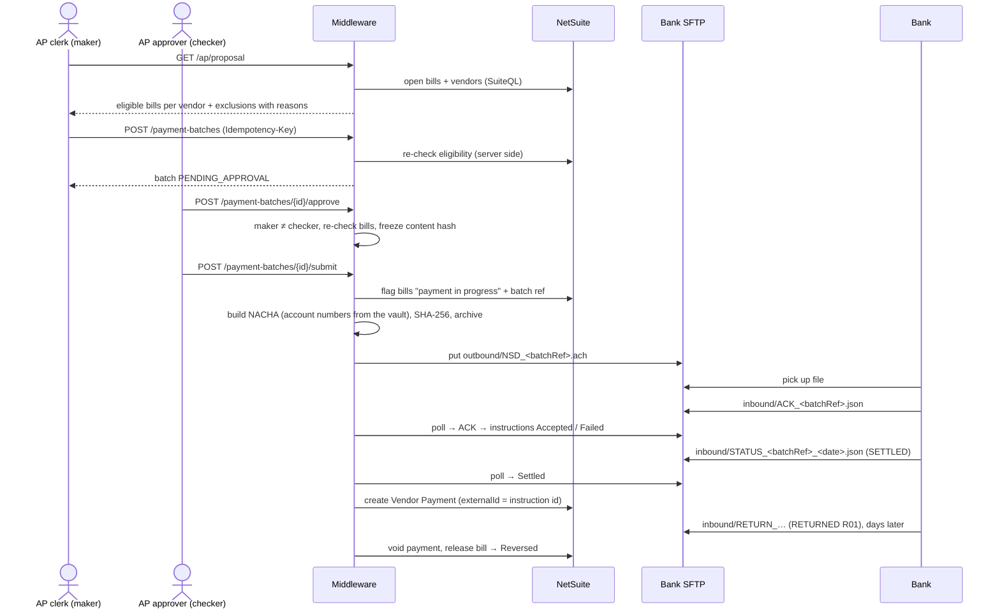

# AP payments design (Phase 7)

## End-to-end sequence

## Data model

| Entity | Key fields | Notes |
|---|---|---|
| `PaymentBatch` | `id`, `batchRef` (immutable, e.g. `PB20261120A1B2C3`), `rail`, `currency`, `status`, `total`, `itemCount`, `makerId`, `checkerId`, `approvedHash`, `file{name, sha256, transmitted}`, `history[]` | One rail and one currency per batch, which means one bank file |
| `PaymentInstruction` | `id` (also the NetSuite Vendor Payment `externalId`), `batchId`, `counterpartyExternalId`, `amount`, `applications[{docExternalId, amount}]`, `status` (PaymentState), `traceNumber`, `bankRef`, `returnCode`, `netsuitePaymentId`, `history[]` | One per vendor per batch. Pays one or more bills. |
| `BankFileRecord` | `id`, `direction`, `name`, `checksum`, `status`, `fileType` | Every file in and out. Used for duplicate detection. |

## Mapping rules

| From | To | Rule |
|---|---|---|
| Eligible bills of one vendor | One instruction | `amount` = Σ `amountRemaining` (decimal-safe). One application per bill. |
| Instruction (ACH) | NACHA entry (6) | Routing and account come from the vault (`bankToken`). Amount in cents. Individual ID = vendor externalId. Trace = ODFI(8) + sequence(7). |
| Instruction (WIRE) | CSV row | `batch_ref, instruction_id, beneficiary_id, beneficiary_name, bank_token, amount, currency, value_date` |
| Instruction (VCARD) | JSON line | `{batchRef, instructionId, vendorId, amount, currency, invoices[]}` |
| ACK entry `ref` | Instruction | Matched by `traceNumber` (ACH) or instruction `id` (wire, vcard) |
| STATUS `SETTLED` | NetSuite Vendor Payment | `externalId` = instruction id, `tranDate` = effective date, apply = applications, `custbody_nsd_provider_ref` = bank ref |
| STATUS `RETURNED` | Void + reopen | Void the Vendor Payment (if posted), clear `custbody_nsd_pay_in_progress`, mark the instruction `Reversed` |

Sample files: `docs/api-contracts/samples/` (`.ach`, ACK, PAYMENT_STATUS).

## Double-payment defences, layered

1. **Eligibility.** `IN_PROGRESS` (the NetSuite flag), `ALREADY_PROPOSED` (open batches in the
   middleware) and `DUPLICATE_BILL` (same vendor and invoice number).
2. **Re-check at approval.** Bills may have changed since the batch was created.
3. **Content hash.** What was approved is exactly what gets sent.
4. **Idempotency-Key** on create and submit.
5. **Deterministic file name, archived bytes.** A retransmission is identical, so the bank detects it
   as a duplicate.
6. **NetSuite `externalId` = instruction id.** Posting twice is impossible.
7. **Duplicate inbound file detection** by SHA-256.

## Review answers

- *Instruction acceptance versus settlement?* Acceptance means the bank agrees to process the
  instruction. Settlement means the money actually moved. Payments can still be rejected or returned
  after acceptance.
- *How do you make sure a vendor bill is not paid twice?* Through the seven layers above.
- *Which statuses trigger NetSuite accounting?* `Settled` creates the Vendor Payment. `Returned` leads
  to `Reversed`, which voids it. Nothing else posts to the GL.
