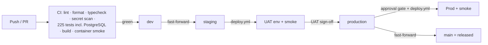

# Deployment, CI/CD and environments (Phase 13)

## Cloud deployment (AWS reference; Azure equivalents in brackets)

```mermaid
flowchart LR
  subgraph Internet
    C[Customers / portal] --> WAF
    P[Payment provider webhooks] --> WAF
  end
  WAF[AWS WAF + ALB<br/>TLS, rate limits] --> ECS
  subgraph VPC[VPC – private subnets]
    ECS[ECS Fargate service<br/>middleware containers ×2+<br/>(Azure Container Apps)]
    RDS[(RDS PostgreSQL<br/>Multi-AZ, encrypted<br/>(Azure Database for PostgreSQL))]
    ECS --> RDS
  end
  ECS -->|SuiteTalk REST over TLS| NS[NetSuite]
  ECS -->|SFTP over SSH| BANK[Bank SFTP]
  SM[Secrets Manager<br/>(Key Vault)] -.->|injected at start| ECS
  ECS --> CW[CloudWatch logs + metrics<br/>(Azure Monitor)]
  S3[(S3 archive, KMS, Object Lock<br/>bank files + audit export)] -.- ECS
```

## Environment matrix

| | local | development / sandbox | UAT (staging) | production |
|---|---|---|---|---|
| Git branch | any | `dev` | `staging` | `production` → `main` |
| Deployed by | developer | CI (optional) | `deploy.yml` on push | `deploy.yml` **after manual approval** |
| NetSuite | mock | NetSuite **sandbox** (TBA) | NetSuite **sandbox** (UAT copy) | NetSuite **production** |
| Bank / provider | simulators | simulators or bank test service | bank **test** SFTP, provider **test** mode | live |
| Storage | memory or Docker PostgreSQL | RDS (small) | RDS | RDS Multi-AZ |
| `DISPATCH_MODE` | inline | worker | worker | worker |
| Data | synthetic | synthetic | synthetic (UAT pack) | real |
| `/dev/*` routes | on | on | **off** (`NODE_ENV=production`) | **off** |
| Who can access | developer | dev team | testers and finance UAT | least-privilege roles |

## Pipeline



**Quality gates.** Nothing is promoted unless all of these pass:

- `npm run ci` (lint, format, typecheck, secret scan, tests)
- the Docker build
- the container smoke test
- for production: the UAT sign-off (`docs/testing/uat-signoff-template.md`)

## What does SDF deploy, and what does the middleware pipeline deploy?

| Artifact | Deployed by | Why |
|---|---|---|
| SuiteScripts, custom fields and records, script deployments, saved searches, workflows | **SDF** (`suitecloud project:deploy`) into each NetSuite account | They live *inside* NetSuite, and each account (sandbox, production) is deployed separately |
| Middleware container, DB migrations | **deploy.yml** (ECS) | They live in our cloud |
| Secrets | Secret manager (manual or automated rotation) | Never part of either build |
| Accounting configuration (accounts, periods, payment methods) | NetSuite admins through change control | It is configuration data, not code |

**Order matters.** When a release adds a NetSuite field that the middleware writes, deploy **SDF
first**, then the middleware. Otherwise the middleware writes to a field that does not exist yet.

## Configuration promotion

- The **same image** (tagged with the git SHA) is promoted from staging to production. It is never
  rebuilt per environment.
- Everything that differs per environment lives in task-definition environment variables or in the
  secret manager: NetSuite account, URLs, limits, secrets.
- NetSuite object IDs stay **the same** across accounts, because we use script IDs (`custbody_nsd_*`)
  and never internal IDs in code.

## Database migrations: expand, then contract

- Migrations run as a one-off task **before** new code receives traffic.
- They must stay compatible with the **previous** release (zero-downtime, rollback-safe):
  1. *Expand.* Add new columns, tables or indexes. Old code ignores them.
  2. Deploy the code that uses them.
  3. *Contract.* Remove the old structure in a **later** release, once no deployed version needs it.
- Never rename or drop in the same release that starts using the new shape.

## Keeping secrets out of build logs

- No secret is in the repo. `check:secrets` enforces this in CI.
- Deploy secrets are GitHub **environment** secrets, which are masked in logs. AWS access uses **OIDC**
  (short-lived role credentials), with no stored keys.
- The app never logs its config, and the logger redacts sensitive fields.
- `docker build` gets no secrets. They are injected only at runtime, by ECS from Secrets Manager.

See `docs/runbooks/deployment-rollback.md` for rollback and forward-fix.
