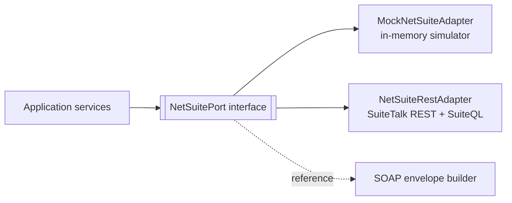

# NetSuite integration design (Phases 5–6)

## The adapter layer

**Why use an adapter layer?** It keeps NetSuite-specific details in one place:

- URLs and authentication (OAuth signing)
- paging
- field names
- error formats

The rest of the code speaks in domain terms such as "create vendor payment for these bills". That
gives three benefits:

- Tests run against the mock, so no licence is needed.
- A NetSuite API change touches one file.
- The system could support another ERP with a new adapter (the plan's "Optional Other ERP Adapters").

## Which API for which operation

| Operation | Approach | Why |
|---|---|---|
| Upsert vendor or customer | REST `PUT /record/v1/vendor/eid:{externalId}` | Creates or updates in one call. The external ID makes it idempotent. |
| Read open bills and invoices | REST SuiteQL (`POST /query/v1/suiteql`) | One query returns many records with only the needed columns, and it pages. |
| Create vendor or customer payment, deposit or refund | REST `POST /record/v1/{type}` with `externalId` | A standard record. The external ID prevents duplicates on retry. |
| Update integration status fields | REST `PATCH …/eid:{externalId}`, or the RESTlet `nsd_rl_integration_status` | The RESTlet allows least privilege. REST PATCH keeps one integration path. |
| Bulk or legacy operations, or records not in REST | SOAP (reference only) | Many existing integrations use it. Check Oracle's deprecation schedule first. |

## RESTlet or SuiteTalk REST?

| | SuiteTalk REST | RESTlet |
|---|---|---|
| Built and maintained by | Oracle | Us |
| Coverage | Standard and custom records, SuiteQL | Whatever we code |
| Business logic inside NetSuite | No | Yes |
| Permission scope | The role needs record permissions | Can be narrowed to exactly one operation |
| Governance | Concurrency limits | Script governance as well |

**Rule used in this project:** use REST for standard CRUD. Use a RESTlet only when we need validation
or logic inside NetSuite, or a narrower permission scope. Never build a "generic query" RESTlet.

## Authentication

**Token-Based Authentication (TBA)** is used here (see `oauth1.ts`):

- It uses OAuth 1.0a with HMAC-SHA256, and every request is signed.
- Tokens do not expire. They are revoked by an admin.
- If one leaks, revoke it in *Setup → Users/Roles → Access Tokens*.

**OAuth 2.0 machine-to-machine** is the alternative:

- The client authenticates with a certificate-signed JWT.
- It receives an access token that is valid for about 60 minutes, and must request a new one before
  it expires.
- A production adapter would cache the token and refresh it shortly before expiry (for example 5
  minutes early).
- If NetSuite returns 401, the adapter would refresh once and retry once.

## Errors: 400, 429 or 5xx?

| Response | Meaning | Our class | Action |
|---|---|---|---|
| 400 with `o:errorDetails` | Business or validation error (closed period, invalid field) | `NetSuiteBusinessError` (permanent) | No retry. DLQ, and a human fixes the data. |
| 400 `CONCURRENCY_LIMIT_EXCEEDED` / 429 | Too many parallel requests | `TransientError` | Retry with backoff and honour `Retry-After` |
| 5xx, timeout, connection reset | NetSuite is unavailable | `TransientError` | Retry with backoff. If retries run out, DLQ and replay later. |
| 401 / 403 | Credentials or permissions problem | `NetSuiteAuthError` | No retry. Alert operations, because it is a configuration issue. |

## Pagination, concurrency and limits

- SuiteQL pages are at most 1,000 rows (`limit` / `offset`, plus `hasMore`).
- NetSuite limits **concurrent** requests per account. The sync service processes records with
  bounded concurrency, and the retry policy adds jitter so that retries do not all arrive together.
- Every request has a 30-second timeout. A hung connection must not block a worker forever.
- Versioning: REST record endpoints are `/record/v1`. Pin the SuiteTalk SOAP WSDL version explicitly.
