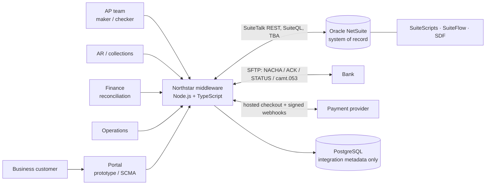
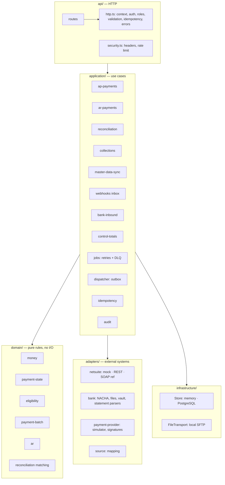

# Architecture overview

## System context

## Inside the middleware (layers)

**Dependency rule:**

- `domain` depends on nothing.
- `application` depends on `domain` and on **ports** (interfaces). Ports are defined in
  `application/ports`, and adapters implement them.
- Only `container.ts` knows which concrete adapter is used. That is what allows a mock, the real
  NetSuite, PostgreSQL or memory to be swapped without touching business code.

## Key flows (with links)

| Flow | Sequence diagram |
|---|---|
| AP: bill → batch → NACHA → bank → NetSuite | `docs/architecture/ap-payments.md` |
| AR: invoice → hosted checkout → webhook → NetSuite → deposit | `docs/api-contracts/webhooks-and-customer-payments.md` |
| Bank statement → reconciliation | `docs/architecture/reconciliation.md` |
| Failure → retry → DLQ → replay; outbox | `docs/architecture/reliability.md` |
| Deployment pipeline | `docs/architecture/deployment.md` |

## Documentation map

| Topic | Document |
|---|---|
| Scope and phases | `plan.md` |
| Decisions | `DECISIONS.md`, `docs/decisions/` |
| Business processes, glossary, exceptions | `docs/business-processes/` |
| Accounting mapping (needs review) | `docs/accounting-mappings/accounting-event-matrix.md` |
| NetSuite: data dictionary, scripts, workflows, searches, SDF | `docs/netsuite/` |
| API (OpenAPI) | `middleware/openapi.yaml` (served at `/api/v1/openapi.yaml`) |
| Field mapping, webhooks, sample files | `docs/api-contracts/` |
| Security, threat model, access control | `docs/architecture/security.md` |
| Performance | `docs/performance/report.md` |
| Testing, UAT, defects | `docs/testing/` |
| Operations: SLOs, alerts, postmortems | `docs/operations/` |
| Runbooks | `docs/runbooks/` |
| What is real and what is simulated | `KNOWN_LIMITATIONS.md` |
| Learning path through the code | `docs/LEARNING_PATH.md` |
| Portfolio: demo, skills matrix, interview prep | `docs/portfolio/` |
