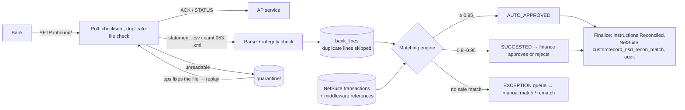

# Bank integration and reconciliation (Phase 10)

## Flow

## Bank adapter interfaces

| Capability | Interface | Implementation here |
|---|---|---|
| Payment file transmission | `FileTransport.put('outbound', …)` | `LocalFolderSftp`, a local folder |
| Status and acknowledgement files | `FileTransport.list/get('inbound')` + `BankInboundService.poll()` | Same |
| Statement import | Same poll, or `POST /api/v1/reconciliation/statements` | CSV and camt.053 parsers |
| Balance and transaction retrieval via API | Not built. The design is a `BankApiPort { getBalance(), listTransactions(from,to) }` mapped to the same `ParsedStatement` | The simulator writes camt.053 balances (OPBD/CLBD) instead |

## File handling controls

| Control | Where |
|---|---|
| SHA-256 checksum per file, with duplicate-file detection | `BankInboundService` and `bank_files` |
| Archive every processed file, and never overwrite an archived one | `LocalFolderSftp.move` (adds a suffix) |
| Quarantine files that cannot be parsed, then replay them | `quarantine/`, `POST /bank/files/quarantine/{name}/replay` |
| Path-traversal protection on file names | `assertSafeName` |
| XML safety: no DOCTYPE or ENTITY declarations, amounts kept as strings | `parseCamt053` |
| Statement integrity: opening + Σ entries = closing | `parseCamt053` |
| Duplicate **lines** across files, keyed by the bank's own reference | `ReconciliationService.importStatement` |

## Matching rules

See `middleware/src/domain/reconciliation.ts`.

| Rule | Confidence | Outcome | Example |
|---|---|---|---|
| `EXACT_REF` | 1.00 | Auto-approved | ACH debit whose EndToEndId is the NACHA trace number |
| `GROUP_REF` (one-to-many) | 0.95 | Auto-approved | One bank debit for a whole ACH batch = the sum of its Vendor Payments |
| `SPLIT_REF` (many-to-one) | 0.90 | Suggested | A payout credited in two parts with the same reference |
| `AMOUNT_DATE` | 0.80 | Suggested | A refund debit with no reference, and exactly one candidate within ±3 days |
| `RECON_AMOUNT_MISMATCH` | — | Exception | The payout reference matches, but the fee was deducted again |
| `RECON_AMBIGUOUS` | — | Exception | Two candidates with the same amount and date. The engine **never guesses.** |
| `RECON_UNMATCHED` | — | Exception | Bank service fee, interest, or an unknown transfer |
| `MANUAL` | 1.00 | Approved | A finance user matches by hand. The amounts must balance exactly. |

**Which transactions are candidates?**

- Vendor Payments: shown negative, from the bank's point of view.
- Customer Refunds: shown negative.
- Deposits: shown positive.
- Reversals of voided Vendor Payments: shown positive. These are the return credits.
- Customer Payments are **not** candidates. They sit in Undeposited Funds and only reach the bank
  inside a Deposit.

## Which unmatched items need human approval?

| Item | Who decides |
|---|---|
| Anything below 0.95 confidence (suggestions) | Finance approves or rejects |
| Every exception | Finance |
| Bank fees and interest | Finance books a journal entry in NetSuite, then matches manually |
| Amount mismatches | Finance investigates the fee or partial payment before matching |
| Rejections | Recorded with a reason. The line goes back to the exception queue. |

## Review answers

**Settlement or reconciliation?**

- *Settlement* is the provider or bank telling us that money moved.
- *Reconciliation* is proving it independently, from the bank statement, to the cent.
- A payment can be "settled" yet missing from the bank. Reconciliation is the control that catches
  that.

**One-to-many and many-to-one.**

- `GROUP_REF` covers one bank line matching many transactions, keyed by the batch reference.
- `SPLIT_REF` covers many lines matching one transaction, keyed by a shared reference.
- In both cases the totals must be exactly equal.
- `manualMatch` accepts any shape, as long as it balances.
