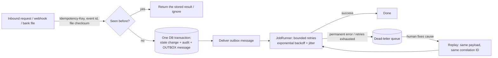

# Reliability patterns (Phase 11)

## How the patterns fit together

| Pattern | Where | Guarantees |
|---|---|---|
| **Idempotency key** | `IdempotencyService` (API POSTs) | The same request with the same key runs once. A different body with the same key gets 409. |
| **Unique external reference** | NetSuite `externalId` = our instruction, intent, settlement or match ID | NetSuite itself refuses a second record. This protects even against bugs in our own code. |
| **Inbox** | `webhook_receipts` (event ID as primary key), `bank_files` (checksum), `bank_lines` (bank reference) | Duplicate deliveries are harmless |
| **Transactional outbox** | `OutboxDispatcher` | Follow-up work is never lost between "state saved" and "work done" |
| **Bounded retries** | `withRetry` | Transient failures heal automatically, and permanent ones are not retried |
| **Dead-letter queue** | `JobRunner` and `/dead-letters` | Nothing is silently dropped, and humans see what failed |
| **Replay controls** | `POST /dead-letters/{id}/replay`, quarantine replay, `rematch` | Recovery after an outage, with the original correlation ID |
| **Crash recovery** | `OutboxDispatcher.recoverStuck()` at start-up | Messages claimed by a dead process are delivered again |

## Retrying or replaying?

- **Retry:** automatic and immediate, within seconds. It is for *transient* blips (429, 503, timeout),
  and is bounded at 4 attempts.
- **Replay:** deliberate, later, after the *cause* was fixed. A human, or a scheduled sweep, re-runs
  dead-lettered work. It reuses the same payload and correlation ID, so the audit trail tells one
  story.

## How idempotency keys and unique external references work together

They protect different boundaries:

1. **Client → middleware.** The `Idempotency-Key` stops a retried HTTP request from creating a second
   batch or intent.
2. **Middleware → NetSuite.** The `externalId` (for example `PI-…` on the Vendor Payment) stops a
   retried or replayed job from creating a second financial transaction. This holds even if the
   middleware lost its own memory of the first attempt.

Both are needed. The first saves work and gives callers a consistent answer. The second is the final
safety net for the general ledger.

## Queues: this deployment versus managed queues

Here the outbox table *is* the queue. The `worker` mode drains it in the background. When volumes
grow, the outbox worker can **publish** messages to a managed queue instead:

| Concept here | AWS SQS | Azure Service Bus |
|---|---|---|
| Outbox message | SQS message (`MessageGroupId` = entity, for per-entity ordering on FIFO queues) | Service Bus message (`SessionId` = entity) |
| IN_PROGRESS claim | Visibility timeout | Peek-lock |
| `recoverStuck()` | The message reappears after the visibility timeout | The lock expires |
| Bounded retries, then DLQ | `maxReceiveCount` plus a redrive policy to a DLQ | `MaxDeliveryCount`, then the dead-letter sub-queue |
| Replay | Move messages from the DLQ back (redrive) | Resubmit from the dead-letter queue |

**Multiple worker processes and PostgreSQL:** claim messages with
`SELECT … FROM outbox_messages WHERE data->>'status'='PENDING' ORDER BY created_at LIMIT 50 FOR UPDATE SKIP LOCKED`.
Two workers then never take the same row. The single-process `chain` used today is not enough across
processes.

## Failure-injection evidence

| Scenario | Test |
|---|---|
| NetSuite 429 or 503, then recovery | `tests/api/integration.test.ts` ("retries a transient blip") |
| Outage longer than the retries → DLQ → replay | Same file ("sends a record to the DLQ…") |
| Crash after commit, before delivery | `tests/reliability/outbox.test.ts` |
| Rollback leaves no phantom message | Same file |
| Duplicate webhooks while the worker is down | Same file |
| NetSuite timeout during batch submission | `tests/api/ap-payments.test.ts` |
| Duplicate bank files and statement lines | AP and reconciliation tests |
