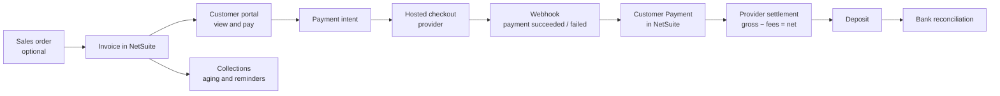

# Business Requirements Document (BRD)

**Company:** Northstar Distribution (fictional) · **Version:** 1.0 · **Phase:** 1

## 1. Purpose

Automate how Northstar pays its vendors (**Accounts Payable**, AP) and collects from its customers
(**Accounts Receivable**, AR). Payments must stay correct, auditable and reconciled to the bank.
NetSuite stays the accounting system of record (see ADR-0001).

## 2. Stakeholders

| Role                      | Needs                                                                 |
| ------------------------- | --------------------------------------------------------------------- |
| AP clerk (**maker**)      | Select approved bills and build payment batches                       |
| AP approver (**checker**) | Approve or reject batches. Must be a different person from the maker. |
| AR / collections clerk    | See overdue invoices, send reminders, record disputes                 |
| Business customer         | View invoices and statements, pay online                              |
| Controller / finance      | Correct GL postings, reconciliation, audit trail, period close        |
| Operations / support      | Monitor integrations, replay failures safely                          |

## 3. Procure-to-Pay (P2P)

```mermaid
flowchart LR
  PO[Purchase order<br/>optional] --> BILL[Vendor bill<br/>entered in NetSuite]
  BILL --> APPR{Bill approval<br/>SuiteFlow}
  APPR -- rejected --> BILL
  APPR -- approved --> ELIG[Eligibility rules<br/>due date, holds, duplicates]
  ELIG --> PROP[Payment proposal]
  PROP --> BATCH[Payment batch<br/>maker]
  BATCH --> CHK{Checker approval}
  CHK -- rejected --> PROP
  CHK -- approved --> FILE[NACHA / wire file]
  FILE --> SFTP[Bank SFTP]
  SFTP --> ACK[Bank acknowledgement<br/>accepted / rejected]
  ACK --> SETTLE[Settlement]
  SETTLE --> VP[Vendor Payment<br/>created in NetSuite]
  VP --> REC[Bank reconciliation]
```

**Requirements**

- **P2P-1:** Only approved, open bills that are not on hold can be proposed for payment.
- **P2P-2:** The same bill must never be paid twice. This is enforced both by duplicate checks and by
  idempotency keys.
- **P2P-3:** A batch needs a maker and a _different_ checker before it is transmitted.
- **P2P-4:** Once approved, a batch is immutable. Any change means a new batch.
- **P2P-5:** A NetSuite Vendor Payment is created only when the bank confirms settlement.
- **P2P-6:** Bank returns (for example ACH R01) must reverse the payment's accounting effect and
  reopen the bill.

## 4. Order-to-Cash (O2C)

**Requirements**

- **O2C-1:** Customers can see only their own invoices. This is enforced on the server.
- **O2C-2:** Card data never touches Northstar systems. A hosted checkout returns a provider token or
  reference instead.
- **O2C-3:** Webhooks are signature-verified and processed exactly once, even when they are delivered
  more than once.
- **O2C-4:** Provider fees are recorded separately from the customer's payment. The customer paid the
  gross amount; the fee is Northstar's expense.
- **O2C-5:** Overdue invoices move through collection stages: reminder 1 → reminder 2 → escalation.
  Disputed invoices are held, and receive no reminders.

## 5. Bank reconciliation

- **REC-1:** Bank statements (CSV or ISO 20022 camt.053 XML) are imported from SFTP. Duplicate files
  are detected by checksum.
- **REC-2:** Each line is matched to a payment, deposit, fee or refund using deterministic rules, and
  every match gets a confidence score.
- **REC-3:** Low-confidence or unmatched lines go to an exception queue for a human to approve.

## 6. Non-functional requirements

- Every operation carries a correlation ID, and retries are bounded.
- There is a full audit trail.
- No secrets or payment data appear in logs.
- Integration status is visible to operations.

## 7. Out of scope

- Real money and live banks.
- Storing card numbers.
- PCI DSS certification.
- Tax.
- Accounting policy decisions. The mapping matrix must be reviewed by a qualified accountant.
