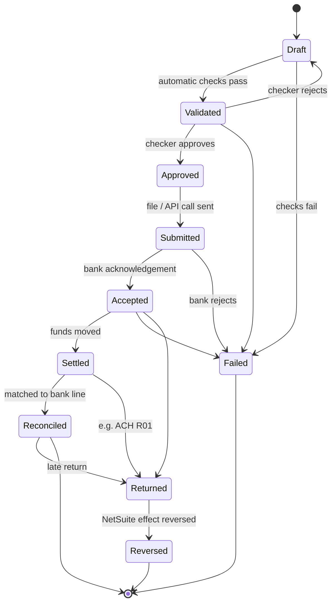

# Payment lifecycle (state machine)

The code for this machine is in `middleware/src/domain/payment-state.ts`. The code and this diagram must
always agree.

## What each state means and what NetSuite does

| State      | Business meaning                          | NetSuite effect                                                                    |
| ---------- | ----------------------------------------- | ---------------------------------------------------------------------------------- |
| Draft      | Proposed, not checked                     | None                                                                               |
| Validated  | Passed the automatic rules                | None                                                                               |
| Approved   | Approved by the checker (maker ≠ checker) | None                                                                               |
| Submitted  | Sent to the bank or provider              | Bill is marked _payment in progress_ (custom field) so it cannot be proposed again |
| Accepted   | Bank accepted the instruction             | None. Acceptance is **not** payment.                                               |
| Settled    | Funds moved                               | **Vendor Payment / Customer Payment is created**                                   |
| Failed     | Rejected before money moved               | The _in progress_ flag is cleared and the bill can be proposed again               |
| Returned   | Money came back after settlement          | An exception is raised for finance                                                 |
| Reversed   | Accounting effect undone                  | **The payment is voided or reversed** and the bill reopens                         |
| Reconciled | Matched to a bank statement line          | The reconciliation reference is stored                                             |

## Payment versus settlement

A **payment instruction** says "please move money". **Settlement** is the money actually moving. They
can be days apart, and an accepted instruction can still fail. That is why accounting entries are
triggered at _Settled_, not at _Submitted_.
