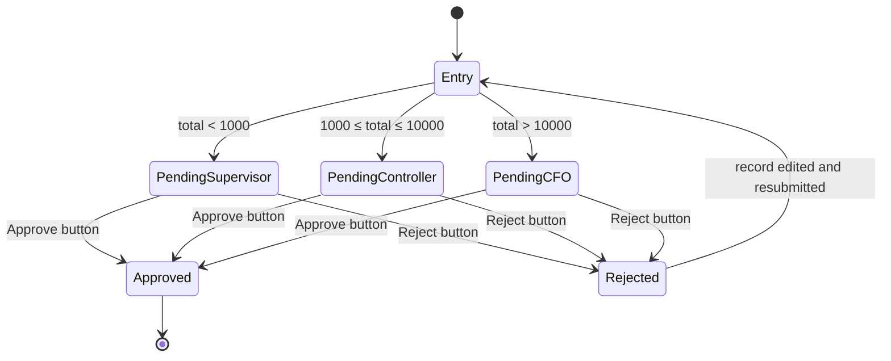

# SuiteFlow workflows (Phase 4)

SuiteFlow workflows are built in the NetSuite UI (*Customization → Workflow → Workflows → New*).
Each spec below lists every state, action and transition, so you can build it step by step. Once it
works, run `suitecloud object:import --type workflow` to bring it into SDF source control as
`Objects/customworkflow_nsd_*.xml`.

The approval thresholds are mirrored in code (`nsd_rules.approvalRoute`) and unit-tested. If you change
a threshold, change it in both places.

---

## 1. AP bill approval: `customworkflow_nsd_ap_bill_approval`

| Setting | Value |
|---|---|
| Record type | Transaction → **Vendor Bill** |
| Initiation | Event-based, on **Create** (and on **Edit** for the *Resubmit* path) |
| Condition | `Approval Status` = Pending Approval |
| Enable logging | ✅ (needed for the test evidence below) |
| Release status | Testing → Released after UAT |

### Approval routing

| Bill total (base currency) | Approver role |
|---|---|
| < 1,000 | NSD AP Supervisor |
| 1,000 – 10,000 | Controller |
| > 10,000 | CFO |

### States

| State | Actions on entry | Buttons and transitions |
|---|---|---|
| **Entry** | Set field `Approval Status` = Pending Approval | Automatic transitions with conditions on `Total` (table above) |
| **Pending (Supervisor / Controller / CFO)** | **Lock Record** (except for the approver role). **Send Email** to the role (template: *NSD Bill Awaiting Approval*). | **Add Button** "Approve" → *Approved*; **Add Button** "Reject" → *Rejected*. Both are visible only to the approver role. |
| **Approved** | Set `Approval Status` = Approved. Set `custbody_nsd_int_status` = PENDING (the middleware picks it up). | — |
| **Rejected** | Set `Approval Status` = Rejected. **Send Email** to the creator with the rejection reason (from a workflow field). | Transition to *Entry* **on Edit** when the creator resubmits |

**Separation of duties:** add the condition `Current User ≠ Created By` on the Approve transition, so a
user cannot approve their own bill.

---

## 2. AR collections: `customworkflow_nsd_ar_collections`

| Setting | Value |
|---|---|
| Record type | Transaction → **Invoice** |
| Initiation | **Scheduled**, daily, after the collections Map/Reduce has run |
| Condition | `Status` = Open **and** `custbody_nsd_dispute` = F |

The Map/Reduce (`nsd_mr_collections.js`) decides the stage. The workflow only **communicates** the
stage. Keeping these two jobs apart keeps the workflow simple, and keeps the rule testable in code.

| State | Entry condition | Actions |
|---|---|---|
| **Reminder 1** | `custbody_nsd_collection_stage` = REMINDER_1 | Send Email (template *NSD Friendly Reminder*) to the customer's AP contact |
| **Reminder 2** | Stage = REMINDER_2 | Send Email (*NSD Second Notice*) and create a Task for the AR clerk |
| **Escalated** | Stage = ESCALATED | Send Email to the AR manager. Set the customer's credit hold (only if policy allows it). |
| **Done** | Invoice paid **or** disputed | Exit the workflow |

The customer communication audit trail comes from three sources:

- NetSuite's *Communication* subtab, which records every sent email;
- the workflow execution log;
- `customrecord_nsd_int_log` entries.

---

## Test evidence

Capture a screenshot or log export for each row. Store it in `docs/evidence/phase-4/`.

| # | Scenario | Expected | Evidence |
|---|---|---|---|
| W1 | Bill of 500 created | State *Pending Supervisor* and an email is sent | Workflow history subtab |
| W2 | Bill of 5,000 created | *Pending Controller* | Workflow history |
| W3 | Bill of 25,000 approved by the CFO | *Approved*, and integration status PENDING | Record view |
| W4 | Supervisor rejects | *Rejected*, and the creator gets an email | Workflow history |
| W5 | Rejected bill edited | Back to *Entry*, then routed again | Workflow history |
| W6 | Creator tries to approve their own bill | Approve button not shown | Screenshot |
| W7 | Invoice at REMINDER_2 | Second-notice email and a task | Communication subtab |
| W8 | Disputed invoice | No reminder sent | Workflow log |
| W9 | Workflow reprocessing (*Initiate Workflow* again) | No duplicate state change | Workflow log |

---

## When to use SuiteFlow and when to use SuiteScript

| Use **SuiteFlow** when… | Use **SuiteScript** when… |
|---|---|
| The process is a set of states with approvals and buttons | You need loops, complex calculations or external calls |
| Business users should be able to see or adjust the steps | Many records are involved (use Map/Reduce) |
| Standard actions (email, lock, set field) are enough | You need unit tests, code review and precise error handling |

## Query patterns that become expensive

- Searches or SuiteQL queries **without** a filter on `type` or a date range. These scan every
  transaction.
- `mainline = F` (line level) when header level would do.
- Formula columns over large result sets.
- Joins to many related records for every row.
- Running a search inside a loop (N+1). Search once with an `anyof` filter instead.
- Reading every page of results when the first page is all you need.

## Not exposing data through an over-permissive RESTlet

See `nsd_rl_integration_status.js`. It uses allow-lists for types, fields and statuses, validates
input, restricts its audience to the integration role, and never takes a "generic search" endpoint
that accepts arbitrary SuiteQL from callers.
