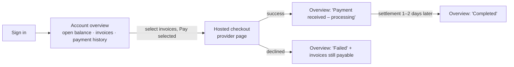

# Customer portal: UX specification and access control (Phase 9)

> The implementation in this repo is a **local prototype** (`portal/local-prototype`). It is served at
> <http://localhost:3000/portal/>. It is **not** a deployed SuiteCommerce MyAccount (SCMA) extension. It
> uses the same API contract an SCMA extension would call. See `portal/scma-extension/README.md`.

## Screen flow

## Views

| View | Content | Data source |
|---|---|---|
| Open balance | Total amount due, per currency | `GET /api/v1/portal/statement` → `openBalance` (from NetSuite open invoices) |
| Invoices | Number, due date, amount due, status (Open / Overdue *n* days / Payment pending / Under review) | `statement.invoices` |
| Payment initiation | Checkboxes, selected total (display only), "Pay selected" | `POST /api/v1/payment-intents`, then redirect to `checkoutUrl` |
| Payment history | Date, invoices, amount, plain-language status | `statement.payments` |
| Statement | The invoices and payments above together (a PDF statement is a future enhancement) | `statement` |

## UI states

| State | What the user sees | Implementation |
|---|---|---|
| Loading | "Loading your account…" (announced by screen readers) | `role="status" aria-live="polite"` |
| Empty | "You have no open invoices. Thank you!" or "No payments yet." | `#invoices-empty`, `#payments-empty` |
| Error | Red message with a support reference (the correlation ID) | `setStatus(..., 'error')` |
| Overdue | Red "Overdue (20 days)" badge | `state: overdue` |
| Pending | "Payment pending" on the invoice, with its checkbox disabled | `state: payment_pending` (prevents double payment) |
| Paid, processing | "Payment received – processing" | Intent SUCCEEDED, not yet settled |
| Paid, settled | "Completed" | The settlement Deposit is posted |
| Confirmation | After returning from checkout: "Payment status: …" | `?returnFrom=checkout&intent=…` |

## Pending versus settled

A card payment that succeeds immediately **removes the invoice balance**, because the NetSuite
Customer Payment is posted at once. The money still reaches Northstar's bank only at settlement. We
show two separate states for these:

- "Payment received – processing" tells the customer: you are done, nothing more to do.
- "Completed" means the funds have settled.

## Accessibility (WCAG 2.1 AA basics)

- Semantic HTML: tables with `<th scope>`, a `<caption>`, labelled inputs, and real `<button>`
  elements.
- Visible focus outline. Keyboard-only operation works.
- Status changes are announced through `aria-live`.
- Colour is never the only signal: every badge also has text.
- The layout adapts at phone width.

## Access-control matrix

| Action | Customer (own) | Customer (other's) | AR clerk | AP / ops |
|---|---|---|---|---|
| View own profile, statement and payments | ✅ | ❌ (data is never returned) | ❌ (uses internal endpoints) | ❌ |
| Create a payment intent for own open invoices | ✅ | ❌ 404 | ✅ (on behalf, any customer) | ❌ |
| Read a payment intent | ✅ own | ❌ 404 | ✅ | ❌ |
| Capture, void or refund | ❌ | ❌ | ✅ | ❌ |
| Simulated checkout page (`/dev/*`) | Development only, never mounted in production | | | |

**Where is authorization enforced?** On the **server**, by the token's subject:

- portal routes have no customer parameter at all;
- `createIntent` only loads the customer's own open invoices from NetSuite.

The browser is never trusted. Tests in `middleware/tests/api/portal.test.ts` prove it.

## Security controls in the prototype

- A Content-Security-Policy (`script-src 'self'`) and `nosniff`.
- All server data is rendered with `textContent`, never `innerHTML` (XSS protection).
- An Idempotency-Key per "Pay" click, so a double-click cannot pay twice.
- The token is kept in `sessionStorage`, which is cleared when the tab closes. Real SCMA uses
  NetSuite's own shopper session.
