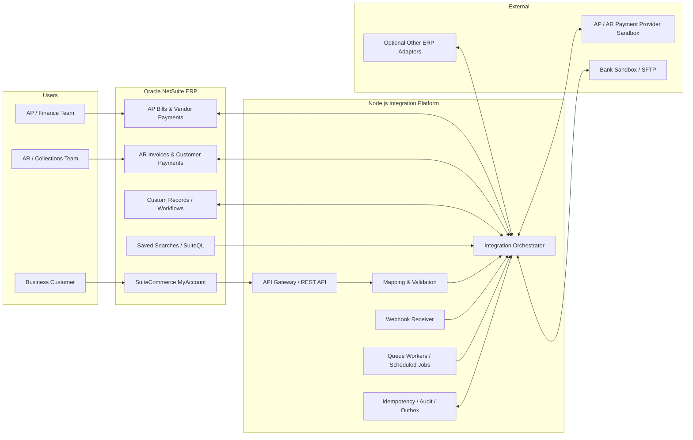

<!-- Generated from NetSuite_AP_AR_Banking_Payments_Learning_Plan.docx. This markdown copy is the working source of scope. -->

# Enterprise AP/AR & Banking Payments Integration Platform
Phase-wise Senior NetSuite Developer Learning & Project Execution Plan

Prepared: 17 November 2026 | Version 1.0

Recommended learning project: Northstar Distribution — Enterprise AP/AR & Banking Payments Integration Platform

### How to use this document

- Follow the phases in order. Each phase includes learning/build tasks, deliverables or exit criteria, and review questions. Do not move to the next phase until you can explain the current phase and demonstrate its acceptance criteria.

Important: NetSuite, SuiteCommerce, payment SuiteApps, bank feeds, and SDF capabilities depend on licensed account access, enabled features, roles, and account version. Use authorized sandbox access. Use synthetic data and simulators when access is unavailable.


## 1. Executive Summary

This plan defines one end-to-end, portfolio-quality learning project designed around the supplied Senior NetSuite Developer job description. The project simulates a mid-sized distribution company that uses Oracle NetSuite as its ERP and connects it to vendor-payment, customer-payment, banking, collections, and customer self-service systems.
The goal is to learn by designing, building, testing, documenting, and deploying a coherent solution—not by collecting disconnected code samples. Each phase introduces a business capability, explains the reason behind it, identifies the NetSuite and Node.js work, and ends with tangible deliverables and acceptance criteria.

Important environment note: NetSuite is a licensed SaaS product. You will need access to an authorized NetSuite account or sandbox for real SuiteScript execution, SuiteTalk authentication, SuiteCommerce MyAccount, SDF deployment, and bank/payment SuiteApps. Where access is unavailable, build the Node.js middleware, mock bank/payment providers, sample payloads, and documented NetSuite scripts/adapters locally. Never use real bank credentials, card data, or production customer information in a learning environment.

## 2. Project Scenario and Business Scope

### Fictional company: Northstar Distribution

- Northstar sells equipment and supplies to business customers. It purchases goods from vendors, receives invoices, pays vendors through banking/payment providers, invoices customers, collects money online, and reconciles bank settlements in NetSuite.

### Business problems to solve

- Vendor invoices arrive in different formats and need validation and approval.
- AP staff need to select approved bills, create payment batches, transmit payment instructions, and track payment status.
- Customers need to view invoices and statements and pay online through a self-service portal.
- Payment providers and banks send asynchronous status notifications and settlement files.
- Finance needs reliable posting, reconciliation, audit history, exception handling, and period-close reporting.
- Operations need monitoring, retries, idempotency, and support tools for failed integrations.

### In-scope capabilities

1. Vendor and customer master data synchronization.
2. AP bill intake, approval, payment proposal, payment file generation, submission, and status updates.
3. AR invoice, statement, online payment, collections, refund/void simulation, and settlement posting.
4. Bank statement import and automated reconciliation assistance.
5. NetSuite custom records, SuiteScript 2.x scripts, SuiteFlow, saved searches, and SuiteQL.
6. Node.js integration services using REST, SOAP, webhooks, JSON, XML, CSV, and SFTP patterns.
7. SuiteCommerce MyAccount design/customization plan and, where licensed, a working portal extension.
8. Security, observability, testing, CI/CD, SDF, cloud deployment, and operational documentation.

### Out of scope for a first learning release

- Handling real money or connecting to a live bank.
- Storing raw card numbers or CVV.
- Claiming PCI DSS compliance based on a tutorial project.
- Replacing a bank's certified payment gateway or a production reconciliation product.
- Production financial advice, tax advice, or unapproved accounting policy decisions.

## 3. Target Architecture

### Logical architecture



### Component responsibilities

- NetSuite: system of record for vendors, customers, bills, invoices, payments, journals, and general-ledger impact.
- SuiteScript: validates and automates NetSuite-side business events; performs bounded work within governance limits.
- SuiteFlow: handles approval and status-driven business processes where declarative workflow is suitable.
- Node.js middleware: owns cross-system orchestration, provider adapters, transformation, retries, webhook intake, file processing, and operational monitoring.
- Provider/bank simulators: emulate payment acceptance, asynchronous status, settlement files, bank statements, and failure scenarios.
- Operational database: stores integration metadata, idempotency keys, job state, webhook receipts, and audit references—not a duplicate general ledger.

### Core design principles

1. NetSuite remains authoritative for accounting transactions and GL impact.
2. Middleware must not silently create accounting entries without a defined business mapping and approval.
3. Every externally initiated operation has a correlation ID and idempotency strategy.
4. Webhooks are authenticated, persisted, acknowledged quickly, and processed asynchronously.
5. Retries are bounded and distinguish transient failures from permanent business errors.
6. Payment state transitions are explicit and auditable.
7. Secrets are stored in a secret manager or secure environment configuration, never committed to Git.

## 4. Technology Stack and Learning Map

Use TypeScript for middleware code and JavaScript/TypeScript-compatible patterns for SuiteScript 2.x. Confirm the account's supported SuiteScript version, enabled features, permissions, and SuiteApp availability before implementation.

## Phase 0 — Learning Environment, Access and Project Setup

Suggested duration: Week 1

### What to build and learn

- Understand NetSuite account types, roles, permissions, subsidiaries, currencies, accounting periods, and sandbox concepts.
- Request or arrange authorized NetSuite learning/sandbox access. Verify SuiteCloud Development Framework (SDF), SuiteScript, SuiteTalk, SuiteCommerce, and relevant payment features are available.
- Install Node.js LTS, npm, Git, an IDE, API client, Docker (optional), and a local database.
- Create repository structure, coding conventions, environment templates, branch policy, and issue board.
- Create fictional company data only: vendors, customers, items, currencies, invoices, and bills.

### Deliverables / exit criteria

- Repository initialized with README, .gitignore, environment example, linting, formatting, and test commands.
- Access checklist completed; unavailable NetSuite-only features documented with local mock alternatives.
- Architecture decision record (ADR) explaining system-of-record boundaries.

### Review questions

- Why does NetSuite remain the accounting system of record?
- What is the difference between production, sandbox, and local simulation?
- Which features require account licensing or administrator enablement?

## Phase 1 — Business Process and Accounting Foundations

Suggested duration: Weeks 2–3

### What to build and learn

- Map procure-to-pay: purchase order (optional), vendor bill, approval, payment, bank confirmation, and reconciliation.
- Map order-to-cash: customer, sales order (optional), invoice, collection, customer payment, deposit, settlement, and reconciliation.
- Study AP, AR, debit/credit, journal entries, GL impact, subsidiaries, currencies, exchange rates, accounting periods, and period close.
- Define payment lifecycle states: Draft, Validated, Approved, Submitted, Accepted, Settled, Failed, Returned, Reversed, and Reconciled.
- Create process maps, accounting event matrix, field glossary, and exception catalogue.

### Deliverables / exit criteria

- Business requirements document (BRD) and process diagrams.
- AP/AR accounting mapping matrix with sample debit/credit examples reviewed by a qualified accounting stakeholder.
- State-transition diagram and business glossary.

### Review questions

- At which point should a vendor bill affect the GL?
- How is a payment different from a settlement?
- What happens when a payment is returned after it was marked as submitted?

## Phase 2 — NetSuite Data Model and Configuration

Suggested duration: Weeks 4–5

### What to build and learn

- Configure the learning account: company preferences, roles, subsidiaries if available, currencies, accounting periods, vendors, customers, items, accounts, and payment methods.
- Explore standard records and transactions: Vendor, Customer, Vendor Bill, Vendor Payment, Invoice, Customer Payment, Deposit, Journal Entry, and Bank Transaction.
- Create custom fields and custom records for external payment reference, provider reference, integration status, idempotency reference, reconciliation batch, and error details.
- Define record ownership, external IDs, required fields, validation rules, and retention policy.
- Create saved searches for unpaid bills, overdue invoices, pending payment batches, failed integrations, and unreconciled settlements.

### Deliverables / exit criteria

- Configured NetSuite account and data dictionary.
- Custom record/field specification and sample records.
- Saved searches with documented filters, columns, and intended users.

### Review questions

- When should you use a standard NetSuite record versus a custom record?
- Why are external IDs useful?
- Which information belongs in NetSuite and which belongs in middleware?

## Phase 3 — SuiteScript 2.x Fundamentals and Automation

Suggested duration: Weeks 6–8

### What to build and learn

- Build a User Event script to validate vendor bill/payment fields and set integration metadata.
- Build a Client Script for user-facing field validation and form behavior; understand that client-side validation is not a security boundary.
- Build a Scheduled Script for controlled polling or maintenance tasks.
- Build a Map/Reduce script to process a large set of eligible bills or invoices in batches; handle governance, yielding, summarize output, and restart-safe design.
- Build a Suitelet for an internal payment-batch review or operational dashboard.
- Build a RESTlet for a narrowly scoped integration endpoint where appropriate; compare it with SuiteTalk REST.
- Use modules, parameters, deployment records, logging, error handling, and script governance monitoring.

### Deliverables / exit criteria

- At least one working example of each required script type in a sandbox or documented mock harness.
- Script deployment guide, test cases, governance notes, and code review checklist.
- Evidence of handling partial failures without duplicating transactions.

### Review questions

- Which logic belongs in User Event, Client, Scheduled, or Map/Reduce?
- What happens when a script exceeds governance limits?
- Why must a Map/Reduce process be restart-safe?

## Phase 4 — SuiteFlow, Saved Searches and SuiteQL

Suggested duration: Weeks 9–10

### What to build and learn

- Create an AP approval workflow with thresholds, role-based approval, rejection, and resubmission.
- Create an AR collections workflow for overdue invoice reminders and escalation states.
- Use workflow conditions, actions, states, transitions, and execution logs.
- Create saved searches for operational monitoring and finance reporting.
- Write SuiteQL queries for invoice aging, vendor payment status, settlement matching, and integration exceptions.
- Compare SuiteQL with saved searches and record APIs; apply paging, filters, and least-privilege access.

### Deliverables / exit criteria

- AP approval and AR collections workflows.
- Saved search catalogue and SuiteQL query library.
- Workflow test evidence for approval, rejection, escalation, and reprocessing.

### Review questions

- When is SuiteFlow preferable to SuiteScript?
- What query patterns can become expensive?
- How do you avoid exposing data through an over-permissive RESTlet?

## Phase 5 — Node.js Middleware Foundation

Suggested duration: Weeks 11–13

### What to build and learn

- Create a TypeScript Node.js service with modular architecture: API, domain, application, infrastructure, adapters, and shared libraries.
- Implement configuration validation, structured logging, correlation IDs, request validation, centralized error handling, and health/readiness endpoints.
- Create REST endpoints for vendor, customer, invoice, bill, payment instruction, payment status, and reconciliation batch operations.
- Add authentication and authorization; implement OAuth 2.0 or token-based flows appropriate to the chosen provider and NetSuite account.
- Build NetSuite adapter interfaces for SuiteTalk REST and SOAP; isolate authentication, pagination, mapping, and API errors.
- Add local PostgreSQL tables for integration jobs, idempotency keys, webhook receipts, audit events, and provider references.

### Deliverables / exit criteria

- Runnable middleware service with OpenAPI specification.
- NetSuite REST/SOAP adapter design and at least one sandbox-backed or mocked flow.
- Automated unit tests, API tests, and local developer setup guide.

### Review questions

- Why use an adapter layer?
- How do OAuth tokens expire and refresh?
- How do you distinguish a 400 business error from a 429 or 5xx transient failure?

## Phase 6 — NetSuite ↔ Middleware Integration

Suggested duration: Weeks 14–15

### What to build and learn

- Connect middleware to NetSuite through SuiteTalk REST and, where required, SOAP.
- Implement vendor/customer master sync and invoice/bill retrieval with external ID mapping.
- Implement secure request signing/authentication as supported by the account and integration method.
- Handle pagination, concurrency, rate limits, governance-related constraints, timeouts, and API versioning.
- Implement request/response transformation, schema validation, dead-letter handling, and replay tooling.
- Document RESTlet versus SuiteTalk decision criteria and avoid exposing privileged internal operations.

### Deliverables / exit criteria

- End-to-end vendor/customer and invoice/bill synchronization.
- Field mapping specification and API contract tests.
- Failure/replay demonstration with correlation IDs.

### Review questions

- How do you prevent duplicate records during a retry?
- What should happen when NetSuite is temporarily unavailable?
- Which integration approach is best for each operation and why?

## Phase 7 — Accounts Payable and Vendor Payments

Suggested duration: Weeks 16–18

### What to build and learn

- Create an AP payment proposal from approved, unpaid vendor bills.
- Apply eligibility rules: due date, currency, vendor status, hold flags, payment method, duplicate invoice checks, and approval status.
- Create payment batches with maker-checker approval and immutable batch references.
- Generate simulated ACH/NACHA, wire, and virtual-card instruction outputs using test data; validate file structure against a documented sample specification.
- Transmit files to a local SFTP sandbox or provider simulator; archive outbound files and store checksums and batch references.
- Process acknowledgements, accepted/rejected responses, returns, and payment status callbacks.
- Create or update NetSuite vendor payment records only after the appropriate verified business event and accounting control.

### Deliverables / exit criteria

- AP workflow from bill eligibility to simulated settlement.
- Payment batch data model, file samples, mapping rules, and operational runbook.
- Test scenarios for duplicate bill, rejected payment, returned ACH, timeout, and partial batch failure.

### Review questions

- What is the difference between payment instruction acceptance and settlement?
- How do you ensure the same vendor bill is not paid twice?
- Which payment statuses should trigger NetSuite accounting transactions?

## Phase 8 — Accounts Receivable, Customer Payments and Collections

Suggested duration: Weeks 19–21

### What to build and learn

- Retrieve open invoices and customer balances from NetSuite.
- Build payment intent creation and hosted-checkout simulation; never store card number or CVV.
- Support payment provider tokens/references, authorization/capture simulation, void/refund flows, and payment failure handling.
- Implement webhook receiver for payment success/failure and verify authenticity before processing.
- Post customer payment/deposit through the defined NetSuite accounting process and map provider settlement fees separately.
- Build collections aging, reminder scheduling, dispute/hold status, and customer communication audit trail.

### Deliverables / exit criteria

- AR lifecycle from invoice to payment and settlement.
- Customer payment API and webhook contract.
- Collections rules and test cases for success, failure, duplicate webhook, refund, and chargeback/return simulation.

### Review questions

- Why is a hosted payment page or tokenization safer?
- How do you handle webhook delivery more than once?
- How should fees and net settlement be represented?

## Phase 9 — SuiteCommerce MyAccount Customer Portal

Suggested duration: Weeks 22–24

### What to build and learn

- Study SuiteCommerce MyAccount architecture, extension points, themes, account pages, and supported customization model.
- Design customer views for invoices, statements, open balance, payment history, and payment initiation.
- Implement or prototype an SCMA extension using the supported account's SuiteCommerce tooling and version.
- Connect the portal to approved NetSuite and payment-provider flows; enforce customer-level data access on the server.
- Add accessible UI states: loading, empty, error, overdue, paid, pending, and payment confirmation.
- Where SCMA licensing/access is unavailable, build a clearly labelled local portal prototype with the same API contract; do not claim it is a deployed SCMA extension.

### Deliverables / exit criteria

- Portal UX specification, screen flows, and access-control matrix.
- Working SCMA extension in an authorized environment or local prototype clearly identified as such.
- Security tests proving one customer cannot access another customer's invoices.

### Review questions

- Where should customer authorization be enforced?
- Which customizations are supported by the deployed SCMA version?
- How should the portal display pending versus settled payments?

## Phase 10 — Bank Integration, Reconciliation and Settlement

Suggested duration: Weeks 25–27

### What to build and learn

- Build bank adapter interfaces for statement import, payment file transmission, status files, and balance/transaction retrieval where sandbox APIs permit.
- Implement SFTP file polling, checksum, duplicate-file detection, archive, quarantine, and replay.
- Parse sample bank statements in CSV and XML; map transactions to payment/provider references.
- Match bank lines to NetSuite payments, deposits, fees, refunds, and settlements using deterministic rules and confidence scores.
- Create an exception queue for unmatched, partial, duplicate, or amount/date-mismatched transactions.
- Post approved reconciliation results using controlled NetSuite records/workflows and maintain an audit trail.

### Deliverables / exit criteria

- Bank file import and reconciliation engine.
- Matching rules, exception queue, reconciliation report, and audit evidence.
- Test data for exact match, partial match, duplicate, fee deduction, return, and unmatched transaction.

### Review questions

- What is the difference between payment settlement and bank reconciliation?
- How do you handle a one-to-many or many-to-one match?
- Which unmatched items require human approval?

## Phase 11 — Reliability, Security, Audit and Performance

Suggested duration: Weeks 28–29

### What to build and learn

- Implement idempotency keys, transactional outbox/inbox patterns, bounded retries with exponential backoff and jitter, dead-letter queues, and replay controls.
- Use queues for long-running workloads; select AWS or Azure managed queue services based on available learning access.
- Secure secrets with a cloud secret manager; rotate credentials and use least-privilege roles.
- Apply TLS, webhook signature verification, OAuth/token hygiene, input validation, PII minimization, and secure file handling.
- Design audit events that record actor, action, timestamp, correlation ID, source, result, and relevant record references without logging secrets or sensitive payment data.
- Load test high-volume batches and measure throughput, latency, error rate, queue age, API usage, and NetSuite governance consumption.
- Document PCI DSS scope considerations; use hosted/tokenized payment methods and test tokens. Do not claim compliance without formal assessment.

### Deliverables / exit criteria

- Security threat model and access-control matrix.
- Retry/idempotency/dead-letter implementation with failure-injection tests.
- Performance report, monitoring dashboard, and audit evidence.

### Review questions

- What is the difference between retrying and replaying?
- How do idempotency and unique external references work together?
- What data must never appear in logs?

## Phase 12 — Testing, UAT and Accounting Reconciliation

Suggested duration: Week 30

### What to build and learn

- Write unit tests for mapping, validation, state transitions, file parsers, and reconciliation rules.
- Write integration and contract tests for NetSuite, payment provider, bank, SFTP, and webhook adapters.
- Run end-to-end scenarios across AP and AR, including partial failure and recovery.
- Perform UAT with finance-style scenarios and obtain sign-off on accounting mappings from a qualified reviewer.
- Reconcile source bills/invoices, payment instructions, provider settlements, bank lines, and NetSuite postings.
- Run regression tests after script, workflow, API, and mapping changes.

### Deliverables / exit criteria

- Test strategy, test data pack, automated test report, UAT scripts, defect log, and sign-off template.
- End-to-end evidence for happy paths and critical failure paths.
- Reconciliation proving transaction counts and amounts balance for the test period.

### Review questions

- Which tests require a real NetSuite sandbox?
- How do you prove no transaction was lost or duplicated?
- What is the exit criterion for UAT?

## Phase 13 — SDF, CI/CD and Cloud Deployment

Suggested duration: Weeks 31–32

### What to build and learn

- Organize NetSuite custom objects and scripts for SuiteCloud Development Framework (SDF).
- Use source control for scripts, objects, deployment configuration, and documentation; keep secrets and environment-specific values out of source.
- Create CI steps for linting, type checks where applicable, unit tests, API contract tests, and packaging.
- Create controlled deployment stages: local, development/sandbox, UAT, and production approval gate.
- Deploy Node.js middleware to AWS or Azure using a container/app service; configure managed database, queue, secret manager, and monitoring.
- Document rollback, forward-fix, configuration promotion, and post-deployment smoke tests.

### Deliverables / exit criteria

- SDF project structure and repeatable deployment instructions.
- CI/CD pipeline with automated quality gates.
- Cloud deployment diagram, environment matrix, and rollback runbook.

### Review questions

- What should be deployed by SDF versus middleware CI/CD?
- How do you prevent secrets from leaking into build logs?
- What is the rollback strategy for a database or accounting mapping change?

## Phase 14 — Operations, Documentation and Senior-Level Readiness

Suggested duration: Weeks 33–34

### What to build and learn

- Create support runbooks for failed batches, expired tokens, duplicate webhooks, bank file failures, reconciliation exceptions, and NetSuite outages.
- Define SLIs/SLOs, alert thresholds, dashboards, on-call escalation, and incident postmortem format.
- Prepare architecture, sequence, deployment, data mapping, API, security, and accounting-flow documentation.
- Conduct code reviews and mentor-style walkthroughs explaining design trade-offs and common failure modes.
- Prepare a portfolio demonstration and interview stories mapped to every JD responsibility and skill.

### Deliverables / exit criteria

- Complete technical documentation and operations handbook.
- Recorded/demo-ready end-to-end walkthrough and architecture presentation.
- JD skills evidence matrix and interview preparation notes.

### Review questions

- How would you explain the design to a finance stakeholder?
- How would you investigate a payment marked settled but missing from the bank?
- What would you change before scaling to multiple subsidiaries or ERPs?

## 5. Suggested Repository Structure

```
northstar-ap-ar-platform/
├── docs/│   
├── architecture/│   
├── business-processes/│   
├── accounting-mappings/│   
├── api-contracts/│   
├── runbooks/│   
└── decisions/
├── netsuite/│   
├── src/FileCabinet/SuiteScripts/│   │   
├── user-events/│   │   
├── client/│   │   
├── scheduled/│   │   
├── map-reduce/│   │   
├── suitelets/│   │   
└── restlets/│   
├── Objects/│   
└── manifest.xml
├── middleware/│   
├── src/│   │   
├── api/│   │   
├── application/│   │   
├── domain/│   │   
├── infrastructure/│   │   
├── adapters/│   │   │   
├── netsuite/│   │   │   
├── payment-provider/│   │   │   
└── bank/│   │   
└── shared/│   
└── tests/
├── portal/│   
├── scma-extension/│   
└── local-prototype/
├── simulators/│   
├── payment-provider/│   
├── bank/│   
└── sftp-fixtures/
├── test-data/
├── infrastructure/
├── .github/workflows/
├── .env.example
├── README.md
└── plan.md
```
Keep NetSuite account-specific object IDs, deployment IDs, credentials, and environment settings outside shared source where appropriate. Use documented configuration and SDF practices for the target account.

## 6. Core Data Entities and Integration Contracts

### Suggested entities

- `IntegrationJob`: job ID, type, status, attempt count, correlation ID, source reference, timestamps.
- `IdempotencyRecord`: idempotency key, operation, payload hash, result reference, expiry/retention.
- `PaymentBatch`: batch ID, payment rail, currency, total amount, item count, approval state, provider/bank reference.
- `PaymentInstruction`: instruction ID, vendor/customer reference, amount, currency, method, status, external reference.
- `WebhookReceipt`: provider event ID, signature verification result, received time, processing state.
- `Settlement`: provider/bank reference, gross amount, fees, net amount, currency, settlement date.
- `ReconciliationMatch`: bank line, NetSuite transaction reference, match rule, confidence, reviewer, status.
- `AuditEvent`: actor/service, action, entity reference, correlation ID, timestamp, outcome.

### Contract guidelines

- Version APIs (`/api/v1/...`) and publish OpenAPI documentation.
- Validate all inbound payloads against schemas.
- Use ISO 8601 timestamps and explicit currency codes.
- Represent money using decimal-safe types/strings; never rely on binary floating-point for financial calculations.
- Carry `correlationId`, `externalId`, and idempotency key through every relevant workflow.
- Keep provider-specific payloads inside adapters; expose stable internal domain models.
- Define webhook event versioning, signature verification, replay protection, and duplicate-event behavior.

## 7. Security, Compliance and Financial Controls

Use sandbox credentials and synthetic records only.
Never store raw card number, CVV, banking passwords, or secret keys in application logs, source control, or ordinary database tables.
Prefer hosted checkout and provider tokenization. Keep payment-card data outside the learning platform's scope wherever possible.
Use least-privilege NetSuite roles, integration records, and permissions.
Verify webhook signatures and protect against replay attacks.
Encrypt traffic in transit and sensitive stored data; use managed secrets and key rotation.
Separate maker and checker roles for payment batch approval.
Enforce limits, duplicate detection, approval thresholds, and immutable audit references.
Maintain segregation between test and production environments.
PCI DSS is a formal compliance program; this project only teaches security-aware design and does not certify compliance.
ACH/NACHA, wire, and virtual-card formats have institution/provider-specific rules. Use approved specifications and sandbox test files; do not transmit real payment instructions.

## 8. Definition of Done and Quality Gates

A phase is complete only when:
1. The business purpose and end-to-end flow can be explained in plain language.
2. Code and configuration are committed to Git with meaningful history.
3. Relevant automated tests pass.
4. Errors, retries, duplicate requests, and partial failures are tested.
5. Logs include useful correlation identifiers but no secrets or prohibited payment data.
6. Data mappings and accounting assumptions are documented and reviewed.
7. A demo or evidence artifact exists.
8. Deployment and rollback/recovery steps are documented.
9. The learner can explain why the selected NetSuite script/API/workflow pattern is appropriate.
Final project acceptance:
A vendor bill can be approved, included in a payment batch, transmitted to a simulated provider/bank, receive a status response, and be reconciled.
A customer can view an invoice in a portal prototype/SCMA environment, initiate a simulated payment, receive a webhook result, and see the updated status.
Bank statement data can be imported, matched, and routed to exceptions when no safe match exists.
Integration failures can be safely retried/replayed without duplicate financial transactions.
CI/CD and SDF deployment steps are documented and repeatable.

## 9. JD Coverage Matrix


## 10. Parallel Certification and Interview Preparation

Do not postpone practical work until certification study is complete. In parallel:
Review the official NetSuite learning/certification paths and current exam objectives.
Build a personal glossary of records, transactions, script types, governance, SuiteTalk, SDF, SuiteFlow, SuiteQL, and SuiteCommerce.
For each JD bullet, prepare one example: requirement, design choice, implementation, test evidence, failure scenario, and result.
Practice explaining accounting impact with a qualified finance/accounting reviewer; do not invent accounting treatment.
Prepare architecture discussions on idempotency, retries, queues, webhooks, API limits, high-volume processing, security, and reconciliation.
Consider SuiteFoundation and SuiteCloud Developer certification paths based on current Oracle NetSuite eligibility and exam availability. Verify official current requirements before booking.

## 11. How to Use This Plan with a Cloud Coding Agent

Use a coding agent (for example, an AI-enabled IDE or cloud development workspace) as an implementation assistant, not as the source of truth for NetSuite behavior or accounting decisions.

### Master instruction to give the coding agent

- You are a senior NetSuite solution architect and full-stack integration mentor. Help me build the Northstar Distribution AP/AR & Banking Payments Integration Platform in small, reviewable phases using this plan.md as the source of scope. Before coding each phase, explain the business process, architecture, NetSuite objects, APIs, security considerations, and expected learning outcomes in beginner-friendly language. Then propose a task breakdown, files to create/change, data model, API contracts, test cases, and acceptance criteria. Do not skip explanations. Do not invent NetSuite APIs, script modules, account features, or SuiteCommerce extension points. If account-specific access or documentation is needed, ask me to verify it. Use mock adapters where real NetSuite/bank/payment access is unavailable and label them clearly. Use synthetic data only. Never use live payment credentials or real card/bank data. Implement idempotency, auditability, bounded retries, and safe error handling. After implementation, explain every important file and function, run tests, show the results, update documentation, and wait for my approval before starting the next phase. Do not claim a feature is production-ready or PCI DSS compliant without evidence and formal review.

### Per-phase prompt template

- We are starting Phase [N] — [phase name] from plan.md. First explain the business goal and concepts I need to learn. Then inspect the existing repository and report what already exists. Propose a step-by-step implementation plan with file names, NetSuite objects, API contracts, test cases, security controls, and acceptance criteria. Wait for my approval before making changes. After approval, implement only this phase, explain the code in detail, run the tests, update the relevant documentation, and list anything that requires a real NetSuite sandbox or licensed feature.

### Working rules

- Complete one phase at a time; do not ask the agent to build the entire platform in one prompt.
- Ask for a design review before large code changes.
- Require tests and a short explanation after each implementation.
- Verify NetSuite-specific behavior against current official Oracle documentation and the target account.
- Keep a `DECISIONS.md`, `LEARNING_LOG.md`, and `KNOWN_LIMITATIONS.md`.
- Use Agile iterations: backlog → design → implementation → review → test → demo → retrospective.

## 12. Risks, Dependencies and Realistic Expectations

The suggested 34-week schedule is a structured learning estimate, not a guarantee. Adjust it to your current NetSuite experience, weekly study time, sandbox access, and the depth of implementation. A learner new to accounting and NetSuite may need longer.

## 13. Final Portfolio Demonstration

Prepare a 20–30 minute demo:
1. Show the Northstar architecture and explain why NetSuite is the accounting system of record.
2. Create or select an approved vendor bill and show the AP eligibility/payment batch flow.
3. Generate a simulated ACH/NACHA or wire file and submit it to the provider/bank simulator.
4. Process an acknowledgement and settlement event; show how the NetSuite payment status is updated.
5. Show a customer invoice in the portal and initiate a simulated online payment.
6. Replay a duplicate webhook and prove no duplicate payment is created.
7. Import a bank statement and show automatic matches plus an unmatched exception.
8. Show audit logs, correlation IDs, monitoring, tests, CI/CD, and SDF deployment documentation.
9. Explain one production incident scenario and the recovery runbook.
Portfolio statement: Describe exactly what ran against a real NetSuite sandbox, what ran against a simulator, and what remains a design/prototype. Be transparent about this distinction in your resume and interviews.
