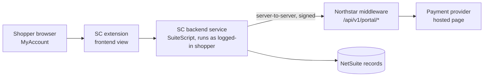

# SuiteCommerce MyAccount extension: design plan

> ⚠️ **Not implemented.** This folder holds a **design** only. No SuiteCommerce licence or site was
> available. Do not describe this as a deployed SCMA extension. The working, clearly labelled
> stand-in is `portal/local-prototype`.

## Goal

Add an *Invoices & Payments* experience to the shopper's MyAccount. It shows:

- open balance
- open invoices with overdue badges
- "Pay selected" through the hosted payment page
- payment history with pending and settled statuses

It is backed by the same contract as the prototype (`GET /api/v1/portal/statement`,
`POST /api/v1/payment-intents`).

## Before writing any code: verify against your account

- Which SuiteCommerce product and version is deployed (SuiteCommerce, SuiteCommerce Advanced, and
  which release). The supported customisation model differs between versions.
- Whether the **extension framework** and the **extension developer tools** are available for that
  version. Use only the extension points documented for it.
- How the site's MyAccount already shows invoices and payments. Many versions include standard
  invoice and payment pages. **Extend or configure those first**, and replace nothing unless needed.
- Which payment methods and processing profiles are configured, and whether the payment SuiteApp
  already provides hosted payment pages.

## Architecture (intended)

**Why a backend service in between?** The browser must never hold middleware credentials. The
SuiteCommerce backend knows which customer is logged in from NetSuite's own session. It calls the
middleware **server-to-server**, asserting that customer's ID, with credentials kept as secrets. The
middleware then applies the same customer scoping as the prototype.

## Implementation steps (once access is verified)

1. Install the extension developer tools for your SC version. Create an extension skeleton with the
   documented scaffolding command.
2. Add a MyAccount child view and a menu entry using the **documented** extensibility APIs for your
   version.
3. Add a backend SuiteScript service that reads the shopper from the session and calls the middleware.
4. Reuse the UX states from `docs/portal/ux-spec.md`, and pass the accessibility checks listed there.
5. Test locally with the developer tools' local server. Then deploy to a **sandbox** site, and only
   after UAT, to production.

## Acceptance (same as the prototype)

- One customer cannot see another customer's invoices. Test this with two shopper accounts.
- Pending and settled payments are displayed as specified.
- No card data touches the extension or NetSuite custom fields. The hosted payment page is used.
